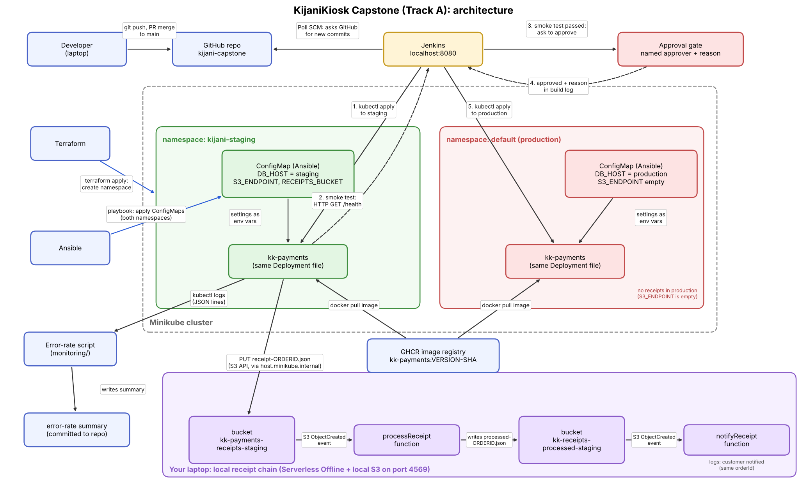

# KijaniKiosk Capstone: Track A (Infrastructure-first)

## 1. What is this?
kk-payments is the KijaniKiosk payments service. Until now it ran in one place only, the default namespace on a local Minikube cluster, and a person edited the version by hand to release it. This project adds a staging environment (the kijani-staging namespace) and a Jenkins pipeline that deploys to staging first, runs a smoke test, and only then asks a named person to approve production. It also connects kk-payments in staging to the Week 10 receipt chain and adds an error-rate check built from the service logs.

## 2. Architecture


- Jenkins: watches this repository and runs the pipeline when main changes.
- Terraform: creates the kijani-staging namespace.
- Ansible: creates the kk-payments ConfigMap in each namespace (DB_HOST, S3_ENDPOINT, RECEIPTS_BUCKET).
- Minikube: runs kk-payments in two namespaces (kijani-staging and default/production) from the same Deployment file, each with its own ConfigMap.
- GHCR: stores the kk-payments image (app/ has the source and Dockerfile).
- Receipt chain (receipts/): two serverless functions run locally with Serverless Offline. The app saves receipt-ORDERID.json to the receipts bucket, processReceipt writes processed-ORDERID.json to the processed bucket, and notifyReceipt logs a customer notification. Only staging is connected to it.
- Monitoring script (monitoring/error-rate.sh): reads the kk-payments logs and writes an error-rate summary.

## 3. Prerequisites
Versions I used (Ubuntu laptop):
- Docker
- Minikube (docker driver) and kubectl
- Terraform 1.16.4
- Ansible core 2.20.1
- Node.js 22 and npm 9 (for the receipt chain)
- Jenkins 2.541.3 running in a Docker container named kijani-jenkins on port 8080

Jenkins needs three things set up by hand, once:
1. kubectl inside the container: copy the kubectl binary into kijani-jenkins.
2. Network access to the cluster: `docker network connect minikube kijani-jenkins`
3. A Secret file credential named `minikube-kubeconfig` that holds a kubeconfig pointing at https://192.168.49.2:8443. Credentials stay in Jenkins and are never committed to this repository.

The Jenkins job `kijani-capstone-pipeline` is a Pipeline from SCM: this repository, branch main, script path `Jenkinsfile`, with Poll SCM set to `H/2 * * * *`.

The laptop firewall (ufw) must let Minikube reach the receipt storage:
`sudo ufw allow from 192.168.49.0/24 to any port 4569 proto tcp`

## 4. Setup
Run from the repository root, in this order.

1. Start the cluster: `minikube start`
2. Create the staging namespace:
   ```
   cd terraform
   terraform init
   terraform apply
   cd ..
   ```
3. Create the ConfigMaps in both namespaces:
   `ansible-playbook -i ansible/inventory/hosts.ini ansible/playbook.yml`
4. Copy the registry secret `kijani-registry-credentials` from the default namespace into kijani-staging:
   ```
   kubectl get secret kijani-registry-credentials -n default -o json | python3 -c 'import sys,json; s=json.load(sys.stdin); [s["metadata"].pop(k,None) for k in ("namespace","resourceVersion","uid","creationTimestamp","managedFields")]; print(json.dumps(s))' | kubectl apply -n kijani-staging -f -
   ```
5. Start the receipt chain and leave it running in its own terminal:
   ```
   cd receipts
   npm install
   npm start
   ```
6. The first deployment is done by the pipeline (next section).

## 5. How to run the pipeline
1. Merge a pull request into main. Jenkins checks the repository every 2 minutes and starts a build when main has changed.
2. Stages: check prerequisites (namespace, ConfigMap and secret exist), deploy to staging (rolls back with `rollout undo` if the rollout fails), smoke test staging (the /health answer must say `"status":"ok"` and DB_HOST must be the staging value), approve production, deploy to production.
3. The approval prompt appears on the build page as **Paused for Input**. Only the approver user can answer it, and a reason is required. The approver and the reason are written to the build log. If nobody answers within 30 minutes, the build stops.
4. If staging fails, production is never offered.

## 6. How to verify it works
Success criterion 1, pipeline: open the build in Jenkins. All stages are green, and the console shows `APPROVED by ... Reason: ...`.

Success criterion 2, same manifest, two environments:
```
kubectl exec -n kijani-staging deploy/kk-payments -- printenv DB_HOST
kubectl exec -n default deploy/kk-payments -- printenv DB_HOST
```
The first prints db.staging.kijani.internal and the second prints db.production.kijani.internal.

Success criterion 3, receipt chain: send one payment to staging.
```
kubectl exec -n kijani-staging deploy/kk-payments -- wget -qO- --header="Content-Type: application/json" --post-data='{"orderId":"ORD-2001","amount":2500}' http://127.0.0.1:3001/payments
kubectl logs -n kijani-staging -l app=kk-payments --tail=20 | grep ORD-2001
```
The app log shows `receipt saved`. The terminal running `npm start` in receipts/ shows `receipt processed` and `customer notified`. All three lines carry the same orderId.

Error rate: `monitoring/error-rate.sh` prints the summary and writes monitoring/summary.txt.

## 7. Known limitations
- Everything runs on one laptop, so losing the machine loses both environments.
- Rollback in production is still a manual step.
- The receipt chain runs locally, not on a cloud provider, and only staging is connected to it. Production leaves S3_ENDPOINT empty and skips receipts.
- DB_HOST is a setting only; there is no real database behind it.
- Terraform and Ansible are run by hand, not by the pipeline.
- The pipeline uses an admin kubeconfig. A real setup would use a limited service account.
- Terraform state is stored locally on the laptop.
- kubectl was copied into the Jenkins container and the container was joined to the minikube network by hand. If the container is recreated, both steps must be repeated.
- The registry secret was copied into staging by hand.
- The Serverless tooling in receipts/ reports npm audit warnings. I left them because it only runs locally.
- The error-rate script needs kubectl access, so it runs from the laptop and not from Jenkins.